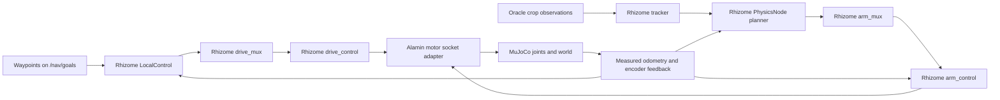

# Native control acceptance in MuJoCo

The same `scene_pipeline.rhizome_agent` entry point now has isolated control
checks. These run normal Rhizome processes on its proxy bus, with no Claude
credential or copied navigation policy. The default agent observation mode is
still stationary; passing a control check does not certify an agent mission.

```bash
export RHIZOME_ROOT=/absolute/path/to/rhizome-checkout
export RHIZOME_HOST_BUILD="$PWD/outputs/rhizome_host/host"
# A fresh build can include executables selected by the native task:
.venv/bin/python -m scene_pipeline.rhizome_build --root "$RHIZOME_ROOT" \
  --output outputs/rhizome_host --task sim-weeding --jobs 3

.venv/bin/python -m scene_pipeline.rhizome_agent --control-test \
  --scene outputs/two_fields_corner --task sim-drive \
  --chassis-configuration gen-3.0 --payload-configuration raptor_4x_30in_gen3 \
  --output outputs/native_drive_check

.venv/bin/python -m scene_pipeline.rhizome_agent --weeding-test \
  --scene outputs/two_fields_corner --task sim-weeding \
  --chassis-configuration gen-3.0 --payload-configuration raptor_4x_30in_gen3 \
  --seconds 15 --output outputs/native_weeding_check
```

The checkout must contain the selected tasks and host infrastructure. A task
owns node membership and overrides; Alamin does not copy controller defaults.
`sim-drive` deliberately selects only wheel control and health from LocalControl.
It does not fake the absent production hardware's health. The required `/odom`
topic feeds LocalControl health, which gates the native drive mux and controller.



Wheel acceptance measures arrival, explicit mux stopping, expired goals and
interrupted odometry. `outputs/native_control_check_06/report.json` passed with
1.02 m measured travel, no MuJoCo warnings and no physics overruns. Its measured
stop times were 0.75 s for selecting NONE, 0.80 s for expired goals, and 0.61 s
for interrupted odometry.

The weeding check uses separate native rover/payload proxies, one motor socket
per device, native arm startup homing and four tracker/planner/control
chains. `AIGEN_HOST_DEVICE_INDEX` and `AIGEN_HOST_ROVER_ADDRESS` are host-only
Rhizome transport settings. Each payload keeps its own IPC directory; Rhizome
adds and removes the normal `@1`/`@2` topic and service suffixes.

`outputs/native_weeding_check_12/report.json` passed: 3.79 m driven during the
15-second weeding phase, all four arms homed, and all four trackers/planners/arm
controllers healthy at completion. The muxes remained in autonomy throughout.
Measured yaw ranges were 0.28–1.05 rad and pitch ranges 0.76–0.89 rad.
There were no MuJoCo warnings or physics overruns; maximum physics lag was
4.6 ms. These are articulation/plumbing checks, not a
weed-removal efficacy measurement.

The physics planner selects `motor_backend: feedback`. Its Box2D model plans
weeding, while actual position feedback comes from MuJoCo. The host-only
`simulated` choice remains available for isolated planner tests.

Oracle input uses scene roots within crop-camera frustums and terrain samples.
It does not model occlusion or run neural inference. The simplified motors start
with ideal calibrated encoders and the CAD's
absolute load-ring tie. Native startup still frees and homes the arms against
simulated mechanical stops; manufacturing calibration is outside this check.
The robot's masses, friction,
geometry and motor electronics remain approximations; plants are not removed.

The native host changes include two fixes exercised by these checks:
`MotorFeedback` must serialize the absolute load angle, and load-axis homing must
hold position during its arrival dwell. The latter has a native regression test
for approaching from both directions and starting inside the arrival tolerance.

A run writes `report.json`, native node logs, public-topic traces and a measured
`physics.jsonl`. Large startup loads complete before the active physics clock.
During the run, physics snapshots, trajectory, sensor/oracle status and control
logs stay in shared memory; the supervisor copies artifacts to the output
directory at shutdown. After activation
an overrun greater than 0.5 s fails the run and removes motor
effort. Native stale-input checks and the wall-clock motor watchdog remain active.

## Agent-session handoff

The reusable hardware path is `rhizome_hardware.connect` plus the physics and
sensor processes in `rhizome_sim_sensors`. `rhizome_control_check` launches the
task's native node processes on isolated rover/payload proxies; its final child
is a test driver that publishes ordinary goals and selects the muxes.

The authenticated agent session still needs to combine this control startup with
the default runner's real `AiAgent`, camera SHM process and credential setup,
replace the test driver with the mission, and test agent-driven stopping and
navigation. No model call was made by these control checks. The current
`--weeding-test` uses oracle crop observations and LocalControl waypoints;
`nav_model` row following and combined camera/agent/control timing are not
certified by its result. Keep task membership and overrides in the selected
Rhizome checkout rather than reconstructing node policies in Alamin.

Focused validation also passed 28 Alamin tests for install/build identity, task
loading, staging, motor I/O and host endpoints, plus 249 native arm-probe
assertions across 8 test cases. Native adapter tests use `RHIZOME_ROOT` and
`RHIZOME_HOST_BUILD`; they compile against the selected checkout.
